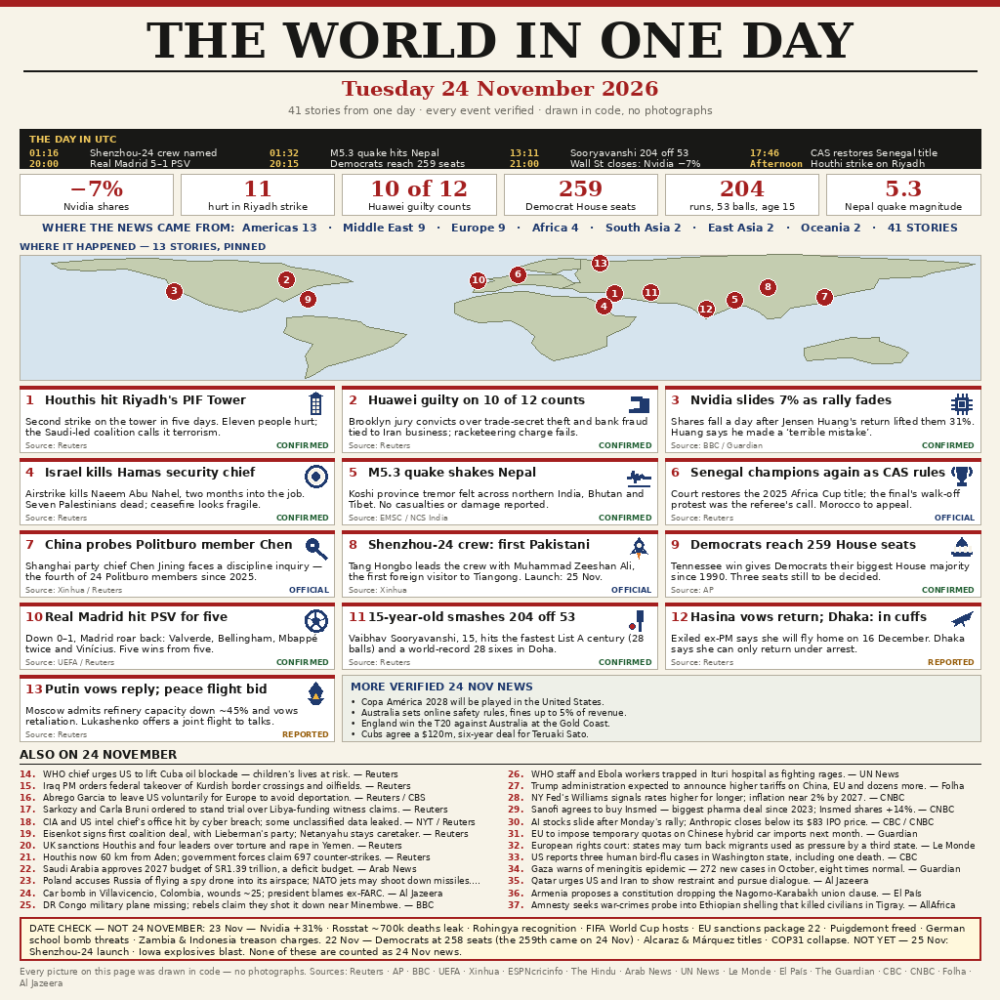

# World News 24 November 2026 in One Image

[](https://make.fun/bounty/news-image-20261124?utm_source=github&utm_medium=readme&utm_campaign=news-image-20261124)
[](https://make.fun/bounty/news-image-20261124/leaderboard?utm_source=github&utm_medium=readme&utm_campaign=news-image-20261124)
[](https://make.fun/bounty/news-image-20261124?utm_source=github&utm_medium=readme&utm_campaign=news-image-20261124)

One picture that sums up Tuesday, 24 November 2026 — built for the
[make.fun bounty "Sum up 24 November's world news in one image"](https://make.fun/bounty/news-image-20261124).



## What the image shows

A front page drawn entirely in code: a serif masthead naming the day,
a timeline of the day in UTC, the day in six numbers, a breakdown of
where the news came from, a world map with the 13 lead stories pinned,
13 numbered story cards, 24 more stories in the "Also" list, and a
small "More verified 24 Nov news" box beside card 13 that carries four
extra items — the Copa América 2028 venue, Australia's new online
safety rules, England's T20 win on the Gold Coast, and the Cubs' deal
for Teruaki Sato — plus a date-check box that names the look-alike
stories from 23 November and the events that had not happened yet.
41 stories in total, every one of them an event of 24 November 2026,
each with its source and a CONFIRMED / OFFICIAL / REPORTED label.

### The 13 lead stories

1. **Riyadh tower struck** — Houthi forces hit the PIF Tower, the
   tallest building in Riyadh, for the second time in five days;
   eleven people were hurt. (Reuters, CONFIRMED)
2. **Huawei convicted** — a Brooklyn jury found the company guilty on
   10 of 12 counts, over trade-secret theft and bank fraud linked to
   its Iran business. (Reuters, CONFIRMED)
3. **Nvidia falls 7%** — the shares gave back part of Monday's 31%
   jump after Jensen Huang returned as chief executive. (BBC /
   Guardian, CONFIRMED)
4. **Gaza security chief killed** — an Israeli airstrike killed
   Naeem Abu Nahel, Hamas's internal-security director in Gaza, two
   months into the post; seven Palestinians died. (Reuters, CONFIRMED)
5. **Nepal earthquake** — a magnitude 5.3 tremor in Koshi province,
   felt across northern India, Bhutan and Tibet, with no casualties.
   (EMSC / NCS India, CONFIRMED)
6. **Senegal champions again** — the Court of Arbitration for Sport
   restored Senegal's 2025 Africa Cup of Nations title. (Reuters,
   OFFICIAL)
7. **Beijing investigates a Politburo member** — Shanghai party chief
   Chen Jining faces a discipline inquiry, the fourth of the 24
   Politburo members since 2025. (Xinhua / Reuters, OFFICIAL)
8. **Shenzhou-24 crew named** — Tang Hongbo will fly with Muhammad
   Zeeshan Ali of Pakistan, the first foreign visitor to the Tiangong
   station. (Xinhua, OFFICIAL)
9. **Democrats take 259 House seats** — their biggest majority since
   1990, after a win in Tennessee. (AP, CONFIRMED)
10. **Real Madrid 5–1 PSV** — Madrid came back from 0–1, with two
    goals from Mbappé and a volley from Bellingham. (UEFA / Reuters,
    CONFIRMED)
11. **A 15-year-old's 204 off 53 balls** — Vaibhav Sooryavanshi set
    the fastest List A century and a world record of 28 sixes in one
    innings. (Reuters, CONFIRMED)
12. **Hasina says she will return** — the exiled former prime
    minister of Bangladesh plans to fly home on 16 December; Dhaka
    says she can only come back under arrest. (Reuters, REPORTED)
13. **Putin vows retaliation** — Moscow admitted its refinery
    capacity is down about 45% after Ukrainian strikes, while
    Belarus's Lukashenko offered a joint flight to peace talks.
    (Reuters, REPORTED)

### The day in numbers

- **−7%** — Nvidia shares
- **11** — people hurt in the Riyadh strike
- **10 of 12** — counts on which Huawei was found guilty
- **259** — Democratic seats in the US House
- **204** — runs by Sooryavanshi, off 53 balls
- **5.3** — magnitude of the Nepal earthquake

## How the entry works

`news.png` is the finished 1024×1024 image (187,776 bytes). `main.py`
is a small Python 3.13 program, standard library only, that copies it
byte for byte to the output path and checks the SHA-256 fingerprint
before and after the copy:

```sh
mkdir -p out && MAKEFUN_OUTPUT_DIR=out python3 main.py
# writes out/entry.png, identical to news.png
```

The image was rendered from scratch with Pillow by `build_24.py`
(kept in the working folder, not part of this repository): masthead,
strips, map, cards and every illustration are vector shapes drawn in
code. No photograph appears anywhere in it; see `PHOTO_CREDITS.md`.

## Date discipline

Only events that happened, or were first reported, on 24 November
2026 are shown as that day's news. The date-check box on the image
lists the traps explicitly: stories from 23 November (the Nvidia
+31% jump, the Rosstat casualty leak, the Rohingya recognition, the
FIFA World Cup host announcement, the EU's 22nd sanctions package,
Puigdemont's release, the German school bomb threats, the Zambia and
Indonesia treason charges) and events still ahead on 25 November (the
Shenzhou-24 launch, the Iowa explosives blast).

## Sources

Every story was checked against its original reporting before it
went on the page: Reuters, AP, BBC, UEFA, Xinhua, ESPNcricinfo,
The Hindu, Arab News, UN News, Le Monde, El País, The Guardian, CBC,
CNBC, Folha and Al Jazeera. Where a story first surfaced a day
earlier and only gained an update on the 24th, the card carries the
update, not the older event — the 259th House seat, for example, is
new on the 24th; the 258th was already counted the day before.

## License

MIT — see [LICENSE](LICENSE).

SPDX-License-Identifier: MIT
